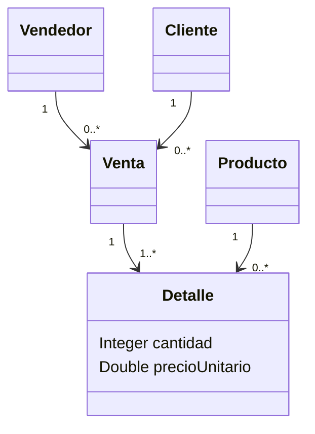

# Primera parte: guía de defensa y APK generada

Revisión: 5 de noviembre de 2026. El objetivo es demostrar cada requisito con un
resultado observable. Compilar una APK no demuestra por sí solo documentación,
interoperabilidad ni el correcto reconocimiento de una fotografía.

## 1. Preparación

1. Abre la carpeta `generador-uml` en tu editor. Abre una terminal allí.
2. Ejecuta `powershell -NoProfile -File scripts/Start-Local.ps1`.
3. Abre `http://127.0.0.1:8765`. Mantén esa terminal abierta.
4. Comprueba que Maven, Java, Flutter y Android SDK estén instalados. La compilación
   comprobada usa Flutter 3.19.6, AGP 8.4.2, Gradle 8.6, Kotlin 1.9.24 y NDK 26.1.10909125.
   El generador configura el proyecto Android; no cambies versiones durante la defensa.
5. Ensaya una compilación antes de la defensa para descargar las dependencias.
   La IA remota requiere Internet y clave configurada en el servidor. Manual, archivos y
   backend local no requieren Render. OCR/transcripción locales necesitan sus recursos descargados.
6. Exporta tu trabajo importante como JSON antes de importar otro modelo.

## 2. Pregunta 1: aplicación completa dentro del alcance

Demuestra el recorrido completo de esta guía: crear el modelo, guardarlo, intercambiarlo,
generar código, compilar, ejecutar backend, probar CRUD e instalar/probar la APK.
No marques esta aceptación cerrada hasta realizar el apartado del teléfono.
Las limitaciones de OCR y reglas empresariales están descritas al final.

## 3. Pregunta 2: tres formas de edición

### Manual

1. Pulsa **Clase** en la izquierda y después un punto vacío del lienzo.
2. En propiedades escribe `Cliente`.
3. En Atributos pulsa **+** y agrega `nombre`, tipo `String`.
4. Cambia un atributo, muévelo en el lienzo y muestra Deshacer/Rehacer.
5. Guarda/exporta JSON. Resultado esperado: una clase editable con su atributo.

### Mediante IA

1. Abre el asistente desde el micrófono y utiliza la conversación del asistente.
2. Solicita: «Crea una clase Producto con los atributos nombre String, precio Double y stock Integer».
3. Revisa las acciones propuestas/aplicadas y compara los atributos en el lienzo.
4. Pide modificar un atributo de esa misma clase y comprueba el cambio.
5. Como alternativa local limitada, dicta dos comandos separados: «Crear clase Producto»
   y «Agregar atributo precio tipo Double a Producto». La transcripción más comandos
   predefinidos no equivale a probar la conversación con IA; muestra también esa función.
6. Si falta clave o conexión, registra el error. No declares probado un servicio que no respondió.

### Imagen/fotografía

1. Usa una foto nítida, recortada, con clases completas y nombres que no existan en el lienzo.
2. Pulsa el icono de imagen junto al micrófono; selecciona la foto y **Interpretar Diagrama**.
3. Compara nombre, atributos, tipos y número de clases con la foto antes de importar.
4. Revisa el texto editable. Corrige un reconocimiento equivocado; el campo debe ser legible.
5. Elige **Agregar al diagrama actual** y acepta la importación.
6. Revisa las conexiones propuestas; confirma clase origen, destino, tipo y multiplicidades.
7. Guarda captura de foto, revisión y resultado. Si falta una clase, la lectura fue parcial:
   complétala indicando que fue corregida, sin presentarla como reconocimiento automático perfecto.

## 4. Modelo de ventas de la pizarra

Para practicar importa `examples/ventas_defensa.json` con el botón **Importar**.
Contiene Venta, Vendedor, Producto, Detalle y Cliente. Los identificadores numéricos
se generan en el backend. Si dibujas otro dominio, define tipos y relaciones antes de compilar.

| Clase | Atributos de ejemplo |
|---|---|
| Vendedor | nombre String, comision Double |
| Cliente | nombre String, email String |
| Venta | fecha LocalDate |
| Producto | nombre String, precio Double, stock Integer |
| Detalle | cantidad Integer, precioUnitario Double |

La clase de asociación de la pizarra se representa para generación como clase intermedia:



Cada Detalle referencia una Venta y un Producto. No agregues además otra relación
muchos-a-muchos directa con una segunda tabla puente. El editor no tiene un símbolo
especial de clase unido por línea discontinua a otra asociación; aquí se modela
explícitamente su estructura persistente. El CRUD permite crear una Venta antes de
sus detalles; no implementa una transacción de cierre de venta ni descuentos automáticos.

## 5. Pregunta 3: ida y vuelta con Enterprise Architect

1. En la web exporta **XMI 2.1**. Guarda el archivo como `Ventas_original.xmi`.
2. En Enterprise Architect crea un proyecto nuevo `.qea` para la práctica.
3. Selecciona el paquete destino. Abre **Import Package from Native/XMI File**.
   El título debe decir **Import**, no Export.
4. Pulsa **Browse**, elige el XMI recién descargado, deja **Import Diagrams** activado y pulsa **Import**.
5. Cierra el diálogo. Abre el diagrama dentro del paquete con doble clic.
6. Comprueba todas las clases, atributos y relaciones; compara también las multiplicidades.
7. Agrega `estado: String` a Venta desde **Features → Attributes** y guarda.
8. Selecciona el paquete que contiene el diagrama y abre **Export Package to Native/XMI File**.
9. Selecciona **XMI 2.1**. Usa **Browse** para guardar una ruta completa con nombre
   `Ventas_modificada.xmi`; no escribas solamente un nombre sin carpeta en Filename.
10. Pulsa **Export**. Cuando termine sin errores, vuelve a GeneradorUML.
11. Conserva antes una copia JSON. Importa `Ventas_modificada.xmi`.
12. Verifica `estado: String`, clases, tipos, relaciones y multiplicidades. Guarda evidencia.
    Si algo cambió, el recorrido no es equivalente todavía: registra exactamente qué cambió.

## 6. Pregunta 4 y objetivo práctico: backend más APK

1. En el modelo que deseas convertir pulsa **Validar** y corrige errores.
2. Pulsa **Generar Código** y escribe un paquete, por ejemplo `com.generador.ventas`.
   Usa otro paquete para otro sistema si quieres conservar ambas apps instaladas.
3. Pulsa **Generar y compilar APK (local)** una sola vez.
4. Observa las etapas: generación, Maven, dependencias Flutter, prueba Flutter, APK y empaquetado.
   El registro contiene salida real. Un error conserva la causa; no representa una compilación exitosa.
5. Al terminar descarga **APK** y **entrega y código**. En disco están en `output/build_<id>/`.
   El ZIP contiene fuente backend/Flutter, diagrama, colección Postman e instrucciones.
6. Anota el identificador `<id>` de esa compilación (carpeta o enlace de descarga).
7. En otra terminal desde la raíz ejecuta:

```powershell
powershell -NoProfile -File scripts/Start-Generated.ps1 -BuildId <id> -Port 8087
```

8. Espera el arranque y abre `http://127.0.0.1:8087/api/health`. Debe indicar `UP`.
   El perfil demo usa H2 persistente en `springboot/data`; el perfil normal usa PostgreSQL.
9. En Postman importa `output/build_<id>/postman_collection.json`.
10. Asigna la variable `baseUrl` a `http://127.0.0.1:8087` (sin `/api`).
11. Ejecuta la colección en orden. Crea primero las entidades referenciadas, conserva sus ID
    y versiones, prueba listados/ediciones y elimina al final en orden inverso.
12. Muestra que una referencia inexistente o una versión obsoleta no se acepta como operación válida.

### APK en teléfono por USB

1. Activa depuración USB en tu Android, conéctalo por cable y autoriza esta computadora en el teléfono.
2. Conserva el backend del paso anterior funcionando.
3. Ejecuta desde la raíz:

```powershell
powershell -NoProfile -File scripts/Install-GeneratedApk.ps1 -BuildId <id> -Port 8087
```

4. El script requiere exactamente un dispositivo autorizado (o el parámetro `-DeviceSerial`),
   comprueba el backend, configura `adb reverse` e instala la APK. No necesita publicar en Render.
5. Abre la app del sistema generado. En su configuración de servidor coloca
   `http://127.0.0.1:8087/api`. Guarda; esta dirección se conserva al reabrir la app.
6. Crea un Vendedor, Cliente y Producto; luego una Venta seleccionando sus referencias;
   crea un Detalle seleccionando Venta y Producto y agregando cantidad/precioUnitario.
7. Consulta esos registros desde Postman. Cambia un precio desde el teléfono y vuelve a consultarlo.
8. Cierra y abre la app; comprueba la dirección guardada y los datos al conectarse.
9. Elimina primero Detalle, luego Venta y después entidades sin referencias. Verifica en Postman.
10. Guarda capturas/video de estos pasos. **Este apartado requiere el teléfono y no está
    sustituido por que Maven o Flutter compilen.** Repite `adb reverse` tras reconectar el USB.

## 7. Pregunta 5: documentación por Proceso Unificado

Presenta `docs/proceso_unificado_pud.md`, esta guía, la arquitectura, el modelo del
generador y el registro `docs/verificacion-2026-11-05.md`. El índice UP relaciona alcance,
requisitos, casos de uso, diseño, componentes, pruebas, despliegue, riesgos y cambios.
Los documentos académicos anteriores están en `docs/entrega`; las evidencias recientes
son un anexo de revisión, no resultados históricos inventados. Datos personales de
carátula y nuevas exigencias de la segunda defensa deben tomarse de la consigna real.

## 8. Límites que deben explicarse

- OCR propone un modelo que requiere revisión; una foto no garantiza reconocimiento total.
- La generación cubre entidades, relaciones y CRUD. Firmas de métodos no definen su lógica.
- La APK es debug instalable para la defensa, no una publicación firmada para Play Store.
- Una app generada necesita su propio backend en ejecución; el servidor del editor no lo reemplaza.
- El botón APK se habilita del lado servidor solamente en localhost con `UML_LOCAL_BUILD=1`.
- La compilación depende de herramientas instaladas y, sin caché previa, acceso a repositorios.
- No hay evidencia de prueba física Android en esta revisión mientras no conectemos un dispositivo.

Referencias operativas: [compilación Android en Flutter](https://docs.flutter.dev/deployment/android)
y [Android Debug Bridge](https://developer.android.com/tools/adb). Consultadas el 5 de noviembre de 2026.
