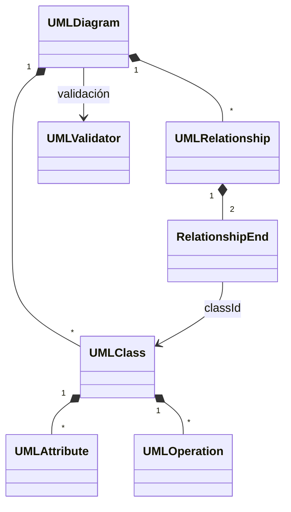
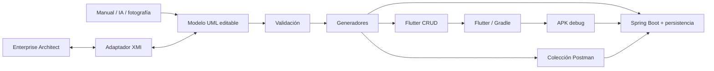
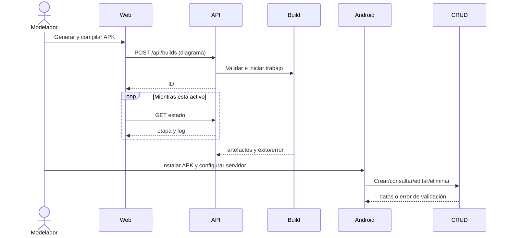

# GeneradorUML: expediente de Proceso Unificado

Revisión técnica: 5 de noviembre de 2026. Alcance: primera defensa y generación de
APK del sistema modelado. Este documento sustituye el borrador metodológico previo;
no se atribuyen fechas de ejecución, mediciones de rendimiento ni pruebas físicas
sin registro. La documentación académica extensa está en
[contenido de entrega](entrega/contenido_revision_completa.md). Esta revisión prevalece
para el flujo de compilación, perfil demo, evidencia y límites actuales.

## 1. Visión, problema y alcance

El modelador necesita transformar un diagrama de clases elaborado en lienzo, voz/IA
o fotografía en un modelo editable, intercambiable y ejecutable como sistema CRUD.
La defensa usa un dominio propuesto por el docente; no debe depender de una aplicación
de ventas escrita a mano. Ventas es un caso de aceptación del generador reutilizable.

Actores: modelador, colaborador con permisos, evaluador, usuario de la app generada.
Sistemas externos: Enterprise Architect, proveedor de IA, repositorios de dependencias,
Android y la base de datos. El editor y el backend generado son aplicaciones diferentes.

El producto cubre edición de clases/atributos/operaciones/relaciones, validación,
serialización JSON, XMI y MDJ, asistencia IA, revisión OCR, colaboración, generación
Spring Boot/Flutter/Postman y compilación Android local. No implementa toda UML ni
deduce algoritmos comerciales a partir de firmas de métodos. No incluye publicación
Play Store, contabilidad certificada, pagos ni seguridad empresarial específica de cada dominio.

## 2. Requisitos y aceptación

| ID | Requisito de la consigna | Criterio verificable | Evidencia |
|---|---|---|---|
| R1 | Aplicación completa | Recorrer todos los casos críticos sin pasos ocultos y registrar fallos | Guía de defensa y acta de prueba Android |
| R2 | Manual, IA, fotos | Crear/cambiar el modelo por cada entrada; revisar diferencias | Pruebas JS/Python, respuesta IA real, demo de usuario |
| R3 | Importar/exportar Enterprise Architect | Ida/vuelta XMI preservando clases, tipos, relaciones y multiplicidades | Fixtures XMI, pruebas roundtrip y revisión en EA |
| R4 | Backend CRUD empresarial/Postman | Código compilable, persistencia, CRUD, referencias y errores coherentes | Maven y colección Newman/Postman |
| R5 | Documentación con UP | Cada requisito enlazado con casos, diseño, implementación y pruebas | Este expediente, arquitectura, manual y anexos |
| R6 | APK del dominio propuesto | Generar desde modelo, compilar, instalar y ejecutar CRUD conectado al backend | Build log, APK, prueba física pendiente |

R6 incorpora el objetivo práctico comunicado por el usuario. La aceptación de R1
depende del recorrido conjunto; no es una propiedad demostrable con un único test.

Requisitos de calidad: errores visibles; recuperación de consulta de un build después
de recargar el navegador; una compilación por servidor; no exponer ejecución de
herramientas en el despliegue público; conservación del diagrama fuente y logs; código
fuente inspeccionable; datos de demo separados de PostgreSQL del sistema.

## 3. Organización UP y registro de iteraciones

Se organiza el expediente por las cuatro fases del Proceso Unificado. Esto es una
trazabilidad de los artefactos presentes, no un cronograma histórico inventado.

| Fase | Objetivo | Artefactos y salida de evaluación |
|---|---|---|
| Inicio | Acordar alcance y viabilidad | Cinco preguntas recibidas, objetivo APK, visión, actores, riesgos |
| Elaboración | Resolver estructura y riesgos principales | Metamodelo, contratos JSON/REST, XMI, generadores y arquitectura |
| Construcción | Implementar incrementos verificables | Editor, IA/OCR, interop, CRUD, Flutter, cola de compilación y scripts |
| Transición | Ensayar entrega y aceptación | Compilación local, Postman, manual, paquete y registro de prueba en teléfono |

Iteración de esta revisión: se añadió la compilación local desde la web, se corrigió
la colección Postman para referencias/versiones, se agregó H2 demo persistente y
se guardó la dirección del backend en la app. El backend y APK de ventas se generan
desde `examples/ventas_defensa.json`. La transición requiere cerrar la prueba física.

## 4. Casos de uso y escenarios de excepción

| Caso | Actor y precondición | Flujo principal | Postcondición / excepción |
|---|---|---|---|
| CU01 Modelar | Modelador con edición | Crear clase, atributos y relaciones; ajustar multiplicidad | Modelo editable; identificadores inválidos se reportan |
| CU02 Validar | Modelo disponible | Ejecutar validador | Errores/advertencias; no se compila modelo vacío o inválido |
| CU03 Colaborar | Enlace con token y servidor | Abrir proyecto, editar, sincronizar revisión | Cambios persistidos; conflictos requieren resolución |
| CU04 Intercambiar | Archivo/modelo | Exportar XMI, abrir EA, modificar, exportar e importar | Verificar equivalencia; dialectos ajenos pueden perder extensión gráfica |
| CU05 Editar con IA/voz | Permiso micrófono cuando se usa voz; IA configurada | Transcribir/solicitar, obtener acciones, revisar y aplicar | Modelo actualizado; error de proveedor visible, no éxito simulado |
| CU06 Interpretar foto | Imagen legible | Detectar cajas/texto, revisar, importar, confirmar conexiones | Modelo editable; lectura parcial se informa y corrige |
| CU07 Generar backend | Diagrama válido | Generar entidades, DTO, servicios, repositorios, REST y Postman | Fuentes Maven; reglas no especificadas no se inventan |
| CU08 Generar app | Mismo modelo | Generar modelos Dart, formularios, servicios y navegación | Cliente CRUD alineado con REST |
| CU09 Recuperar conexión | Copia local y servidor | Conservar cambios, reintentar y resolver conflicto | Evita dar por sincronizado un cambio pendiente |
| CU10 Compilar APK | Servidor local habilitado y herramientas | Solicitar build, observar log, descargar entrega | APK y ZIP solo tras éxito; fallo conserva causa y libera cola |
| CU11 Probar dominio | Backend y teléfono conectado | Configurar URL, crear/leer/editar/borrar con relaciones | Datos comprobados en Postman; red inaccesible se reporta |

CU10 detallado: POST de diagrama y paquete → validar → asignar ID → generar en
carpeta aislada → Maven package → Flutter pub get → Flutter test → Flutter build
apk --debug → verificar archivo → empaquetar → estado succeeded. El navegador
consulta el estado; cerrar la pestaña no cancela el hilo del servidor. Reiniciar
el servidor requiere iniciar otro trabajo; no hay reanudación de una compilación interrumpida.

## 5. Análisis y metamodelo

El diagrama contiene IDs estables y nombres; atributos contienen tipo y restricciones;
las relaciones contienen extremos y multiplicidades. Las coordenadas son datos de
presentación. Los generadores comparten el contrato REST para nombres/rutas y referencias
por ID. El modelo interno es el punto común de todas las entradas.

En ventas, Detalle normaliza la clase de asociación entre Venta y Producto. Incluye
cantidad y precioUnitario; sus referencias son ventaId y productoId. Las operaciones
de una venta completa no son una única transacción del CRUD: crear cabecera y detalles
se demuestra en orden. No se infiere rebaja de stock ni cálculo de comisión.

## 6. Diseño y arquitectura (vistas 4+1)

Vista lógica: editor/modelo, validación, adaptadores XMI/MDJ, asistentes, generadores,
colaboración y orquestador local. Vista de desarrollo: `frontend/js`, `backend/app/models`,
`backend/app/services`, `tests`, `scripts`, `docs` y salidas en `output`.

Vista de procesos: HTTP sirve el editor y contratos; WebSocket maneja colaboración;
un hilo serializa builds y ejecuta procesos Maven/Flutter. Cada comando escribe log,
tiene tiempo límite y devuelve código de salida. El estado se escribe de forma atómica
bajo bloqueo. No es una cola distribuida; ejecutar un único proceso servidor de builds.

Vista física: editor local 127.0.0.1:8765, backend generado 127.0.0.1:8087 y teléfono
por USB con `adb reverse`. H2 demo persiste bajo la salida generada; PostgreSQL sigue
disponible en el perfil normal. Render mantiene editor/API pero no herramientas de build.

Vista de escenarios: CU10 y CU11 recorren los componentes anteriores. Secuencia:

## 7. Reutilización y decisiones

FastAPI/Pydantic gestionan HTTP y entrada estructurada; OpenCV/Tesseract interpretan
imágenes; componentes de transcripción procesan audio; Gemini interpreta solicitudes
en línea. Spring Data JPA/Hibernate implementan persistencia; Flutter compone pantallas;
SharedPreferences conserva configuración. Maven, Gradle y Android SDK producen binarios.
El código propio conecta estos componentes, define metamodelo, validaciones y plantillas.

ADR01: un modelo común evita tres generadores distintos para manual/voz/foto.
ADR02: DTOs con IDs evitan enviar grafos cíclicos completos por REST.
ADR03: compilación solo local evita ejecutar herramientas desde el servicio público.
ADR04: H2 demo reduce requisitos durante ensayo; no sustituye validación PostgreSQL
en un despliegue que lo requiera.
ADR05: errores OCR/IA se revisan, no se ocultan como importación perfecta.
ADR06: APK debug acelera ensayo; firma de publicación queda fuera del objetivo de defensa.

## 8. Implementación y gestión de configuración

Cambios actuales: `build_pipeline.py`, endpoints `/api/builds`, panel de progreso,
perfil demo del generador Spring, persistencia de URL Flutter, colección Postman,
scripts de arranque/instalación y estilo legible para revisión OCR.
Los proyectos generados no se versionan (`output/build_*`). Cada uno incluye diagrama,
fuentes, pruebas, colección y logs. No incluir `.env`, tokens o bases de datos de
ejecución en entrega. Los cambios de esta revisión no fueron enviados a producción.

Los archivos existentes del proyecto se conservan. Los documentos anteriores que
afirman cierre total se consideran históricos; la matriz de aceptación vigente es
el registro de esta revisión. No se fabrican entrevistas, asistencia ni aprobación docente.

## 9. Verificación y trazabilidad

| Requisitos | Diseño / implementación | Pruebas reproducibles |
|---|---|---|
| R2 manual | modelo y editor JS | comandos, operaciones móviles y validación Python |
| R2 IA | gemini_assistant, conversational-assistant | respuesta real registrada; pruebas de acciones y conexión |
| R2 foto | photo_interpreter, local-ai, revisión | fixtures de cruces/marcadores/segmentación/visibilidad |
| R3 | adaptadores XMI/MDJ | test_interop_roundtrip, test_interop_samples, test_xmi_roundtrip |
| R4 | springboot_generator, rest_contract, postman_generator | Maven package y ejecución Newman contra ventas |
| R6 | flutter_generator, build_pipeline, API/panel | Flutter test, build APK real desde botón y pruebas de cola/seguridad |
| R1 | recorrido completo | ensayo guiado y prueba física de aceptación |
| R5 | expediente y anexos | revisión de enlaces, alcance, evidencias y pendientes |

Resultados concretos y rutas: [registro de verificación](verificacion-2026-11-05.md).
La cantidad de tests no prueba todos los diagramas posibles. Pruebas con fixtures
no certifican todos los dialectos de EA ni reconocimiento de cualquier escritura a mano.

## 10. Riesgos y transición

| Riesgo | Tratamiento | Evidencia de cierre necesaria |
|---|---|---|
| Sin Internet en defensa | Ensayo local y precarga de herramientas/modelos | Repetir recorrido con recursos disponibles |
| Foto ilegible o detección parcial | Revisión editable y comparación con original | Captura antes/después sin omitir errores |
| Gradle/Java/SDK incompatibles | Scaffold fijado y log visible | APK de cada modelo de ensayo |
| Backend inaccesible desde teléfono | USB reverse y URL persistente | CRUD físico y contraste Postman |
| XMI pierde multiplicidad | Comparación semántica de ida/vuelta | Diagrama EA y reimportado concordantes |
| Reglas no expresadas | Declarar alcance CRUD y solicitar reglas | Casos de uso específicos adicionales |
| Confundir editor APK con app generada | Nombre/paquete por dominio y demo de datos | Abrir ventas, no solamente el editor |

Entrega: código del generador, ejemplos, documentación, APK/ZIP de cada build,
colección Postman y registros. Operación diaria y resolución de errores:
[guía paso a paso](primera-parte.md). La prueba física es el punto de aceptación
pendiente; no hay dispositivo conectado en esta revisión.

## 11. Fuentes y anexos

- OMG. (2017). [UML 2.5.1](https://www.omg.org/spec/UML/2.5.1/About-UML).
  Referencia del lenguaje; no constituye certificación de implementación completa.
- Flutter. (s. f.). [Build and release an Android app](https://docs.flutter.dev/deployment/android).
  Consultado el 5 de noviembre de 2026 para compilación e instalación.
- Android Developers. (s. f.). [Android Debug Bridge](https://developer.android.com/tools/adb).
  Consultado el 5 de noviembre de 2026 para conexión de dispositivo e instalación.
- Las fuentes de fundamentos CASE, componentes y UP están desarrolladas en
  [documentación académica](entrega/contenido_revision_completa.md), sección 2 y referencias.
- Modelos del sistema y ejemplos editables: `docs/diagramas` y `examples`.
- Arquitectura detallada: [arquitectura](arquitectura.md); instrucciones vigentes:
  [primera parte](primera-parte.md).
